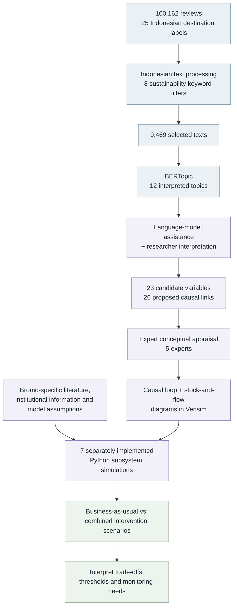

<div align="center">

# 🌋 Language Models & System Dynamics for Overtourism

### Turning visitor experiences into questions about sustainable destination management

**An exploratory study of 25 Indonesian tourism destinations, with Bromo Tengger Semeru National Park as a scenario-modeling case.**

[](https://github.com/marsasalsabila/Coding_Data_Asset_Research_Tourism)
[](https://www.python.org/)
[](https://maartengr.github.io/BERTopic/)
[](https://vensim.com/)
[](https://github.com/marsasalsabila/Coding_Data_Asset_Research_Tourism/actions/workflows/reproducibility-tests.yml)

**[Research overview](#-what-is-this-research-about) · [Why it matters](#-why-this-matters) · [Research workflow](#-how-the-study-works) · [Explore the code](#-code-and-research-assets) · [Reproducibility](#-reproducibility-and-research-checks)**

</div>

---

> **Source-data correction (11 November 2026):** [Read the audited Bromo source register](reproducibility/docs/BROMO_SOURCE_AUDIT_2026-11-11.md) and [run the new provisional annual-mean scenario](reproducibility/scripts/source_grounded_bromo_scenario.py). Seven legacy notebooks are **not yet fully corrected or independently validated**. Their embedded figures remain **stale** after the input correction. Do not reuse historical MAPE 6.45% as independently reproduced evidence.

## 🔎 What is this research about?

Tourism creates jobs and local income. It can also place pressure on public infrastructure, environmental resources, cultural practices, and the lives of people who call a destination home.

**The central question is not simply “How many tourists are too many?”**

It is **how different sustainability pressures might interact**, and how destination managers can examine alternative responses without assuming that a single visitor-capacity number measures every kind of impact.

The project combines **visitor-review topic modeling**, **language-model-assisted conceptual mapping**, and **system dynamics scenario analysis**. The nationwide review corpus helps identify *perceived tourism themes*. A separate Bromo case provides the context for exploring *conditional management scenarios*.

> **In one sentence:** We use the language of visitor experiences to inform hypotheses about a tourism system, then explore how proposed management interventions could affect different destination indicators.

### Ringkasan Bahasa Indonesia

Penelitian ini mengkaji bagaimana ulasan wisatawan dapat membantu mengidentifikasi isu keberlanjutan pariwisata. Tema dari ulasan digunakan untuk menyusun variabel dan dugaan hubungan antarkomponen destinasi. Studi kasus **Taman Nasional Bromo Tengger Semeru** kemudian digunakan untuk mengeksplorasi skenario pengelolaan, seperti penyesuaian tiket, penanganan sampah, fasilitas, pelatihan, pelestarian budaya, dan aktivitas pedagang lokal.

**Manfaat utamanya:** membantu pengelola melihat potensi *trade-off* antara kunjungan wisata, ekonomi, lingkungan, budaya, dan kapasitas operasional. Hasil simulasi adalah **eksplorasi berdasarkan asumsi**, bukan ramalan pasti kondisi Bromo pada tahun tertentu.

## 📌 Research at a glance

| 25 destinations | 100,162 reviews | 9,469 texts | 12 topics |
|:---:|:---:|:---:|:---:|
| Indonesian destination labels | Assembled Google Maps review records | Retained by sustainability-related keyword filtering | Interpreted non-outlier BERTopic themes |

| 23 variables | 26 proposed links | 5 experts | 7 subsystems |
|:---:|:---:|:---:|:---:|
| Candidate system variables | Hypothesized causal relationships | Conceptual and policy-relevance assessment | Separately implemented Python simulations |

**Two analytical scopes, two different jobs:**

- **Cross-destination text analysis:** explores recurring sustainability-related perceptions in reviews from 25 Indonesian destination labels.
- **Bromo scenario modeling:** uses local institutional information, literature, expert interpretation, and explicitly specified model inputs to examine one illustrative volcanic national-park setting.

The 25-destination corpus is not treated as a representative probability sample. Themes extracted from reviews are not direct measurements of ecological health or proof of causal relationships.

## 🌱 Why this matters

Tourism decisions are often discussed as if visitor growth, ecosystem conditions, cultural continuity, and local income move together. In reality, they can develop differently.

This research provides a **structured way to ask better management questions**:

| Decision area | What the scenario framework can help examine |
|---|---|
| **Visitor access** | How modeled visitor pressure responds to admission-price settings and operating benchmarks |
| **Waste and sanitation** | Whether projected waste generation remains within modeled handling capacity |
| **Facilities** | How investment assumptions affect the capacity available to accommodate visitors |
| **Cultural preservation** | How an assumed cultural-sustainability indicator behaves under alternative management settings |
| **Local livelihoods** | How visitor activity and vendor-management assumptions relate to projected vendor numbers and income |
| **Governance** | Which indicators require field measurement, monitoring, and stakeholder consultation before policy adoption |

The practical contribution is **multidimensional monitoring and scenario-informed discussion**, not an automatically optimal ticket price, an authorized vendor quota, or a predicted ecological crisis date.

## 🧭 How the study works

The workflow links *three different kinds of reasoning* without presenting them as interchangeable evidence.



1. **Listen to visitor experiences:** organize review text with a documented sustainability-keyword selection and BERTopic.
2. **Develop conceptual hypotheses:** interpret twelve topics and propose system variables and causal links with language-model assistance and researcher review.
3. **Represent feedback:** prepare causal loop and stock-and-flow diagrams in **Vensim**.
4. **Explore scenarios:** calculate trajectories using **Python in Google Colab**, with seven numerical subsystems implemented separately.
5. **Interpret, don't over-predict:** examine policy trade-offs while distinguishing modeled reference points from observations.

## 📈 Main scenario insights

The following are **results reported in the manuscript**, under the study's specified model assumptions.

| Modeled indicator | Reported illustration | How to read it |
|---|---|---|
| **Cultural sustainability** | Business-as-usual cultural index reaches an assumed threshold of **60 around 2031** | An index-based cultural benchmark, not an observed ecological tipping point |
| **Visitor activity** | Business-as-usual reaches an assumed **2,752 visitors/day** operational benchmark **in August 2038** | An operational modeling reference, not an independently established ecological carrying capacity |
| **Waste management** | Intervention capacity rises toward approximately **2,639 kg/day** in the displayed scenario | Depends on the assumed sanitation-capacity expansion mechanism |
| **Facility investment** | A modeled facility-capacity trajectory approaches a specified reference of **3,500** | The numerical capacity setting is not proof of ecological sustainability |
| **Vendor management** | An intervention illustration limits the modeled vendor count to **450** | A scenario setting, not an evidence-based official quota |

**Important distinction:** the cultural threshold near 2031 and the operational visitor benchmark in August 2038 describe **different constructs**. Their dates cannot be subtracted to establish a verified “ecological warning window.” Not all figures in manuscript versions correspond exactly to the checked-in code revisions.

### What is compared?

The study examines **business-as-usual** against a **combined intervention scenario** that considers:

- Admission-pricing adjustments
- Sanitation-capacity expansion
- Tourism-facility investment
- Workforce training and service improvement
- Cultural-preservation support
- Management of informal-vendor activity

These measures are bundled in the scenario analysis. The results **do not isolate a separately estimated causal effect for every intervention**.

## 🗂️ Code and research assets

This is the existing research repository, with the original notebooks preserved at the root.

| Research asset | Open notebook | What it covers |
|---|---|---|
| Topic modeling | [`BERTopic.ipynb`](BERTopic.ipynb) | Review-based topic discovery |
| Visitor activity | [`Tourist_Population_Subsystem.ipynb`](Tourist_Population_Subsystem.ipynb) | Visitor trajectories, pricing assumptions, operational benchmark |
| Waste management | [`Environmental_Sanitation_Subsystem.ipynb`](Environmental_Sanitation_Subsystem.ipynb) | Waste generation and sanitation handling |
| Tourism revenue | [`Tourism_Revenue_Subsystem.ipynb`](Tourism_Revenue_Subsystem.ipynb) | Revenue trajectories and admission pricing |
| Facilities | [`Tourism_Facilities_Availability_Subsystem.ipynb`](Tourism_Facilities_Availability_Subsystem.ipynb) | Facility investment and modeled capacity |
| Service quality | [`Tourism_Services_Subsystem.ipynb`](Tourism_Services_Subsystem.ipynb) | Service quality and training |
| Cultural preservation | [`Cultural_Preservation_Subsystem.ipynb`](Cultural_Preservation_Subsystem.ipynb) | Cultural-sustainability index |
| Local economy | [`Economic_Subsystem_of_the_Local_Community_in_the_Tourism_Sector.ipynb`](Economic_Subsystem_of_the_Local_Community_in_the_Tourism_Sector.ipynb) | Informal vendors and modeled income |

**Supporting materials**

- [**Figure-to-code crosswalk**](reproducibility/docs/FIGURE_CROSSWALK.md) — which notebook is relevant to each manuscript figure
- [**Computational provenance**](reproducibility/docs/PROVENANCE.md) — how to interpret the research artifacts and version differences
- [**Reproducibility utility guide**](reproducibility/README.md) — scripts and expected input formats
- [**Unit tests**](reproducibility/tests/test_analysis.py) — checks for additional data-processing utilities, not a substitute for empirical model validation

The Vensim figures are **conceptual model diagrams**. The seven Python notebooks are **separately implemented numerical subsystems**, not a demonstrated single, fully coupled simulator.

## ▶️ Getting started

### Explore the original notebooks

Use **Google Colab** or **Kaggle Notebooks** to inspect the source code. Some original cells contain Colab-specific imports, local output paths, or assumptions about input files, so a notebook may require environment adjustments before running in Kaggle.

1. Download or clone the repository.
2. Open `BERTopic.ipynb` or a specific subsystem notebook.
3. Read the parameter and input-data cells before execution.
4. Provide only review data you are entitled to use.
5. Record your environment, input version, source commit, and any code changes.
6. Compare calculated outputs with the corresponding manuscript figure before claiming exact reproduction.

```bash
git clone https://github.com/marsasalsabila/Coding_Data_Asset_Research_Tourism.git
cd Coding_Data_Asset_Research_Tourism
```

### Run the additional reproducibility utilities

These tools check selected calculations or process **your own supplied input files**. They do not replace the original research notebooks.

```bash
python -m pip install -r reproducibility/requirements.txt
python -m unittest discover -s reproducibility/tests -v
```

For example, compute error metrics from supplied paired data:

```bash
python reproducibility/scripts/compute_mape.py reproducibility/examples/synthetic_fit.csv
```

Or inspect first modeled threshold crossings from a CSV export:

```bash
python reproducibility/scripts/find_crossings.py \
  reproducibility/examples/synthetic_visitor_daily.csv \
  --value-column visitors --threshold 2752
```

**The example CSV files are synthetic teaching fixtures**, not observations from Bromo and not the basis for the published results.

## 🔬 Reproducibility and research checks

We distinguish **available code**, **reproduced calculations**, **conceptual assessment**, and **independent empirical validation**.

| Documented assessment | Reported result | What it supports |
|---|---|---|
| Historical fit across seven subsystems | Mean reported **MAPE = 6.45%** | The specified historical comparisons, with baseline treatment noted in the manuscript |
| Local-economy fit | **MAPE = 15.60%** | A subsystem result above the study's 15% criterion |
| Expert conceptual appraisal | Five experts, mean reported rating **3.73/4** | Conceptual plausibility and policy relevance, not predictive accuracy |
| Bromo topic stability | Mean pairwise adjusted Rand index **0.364** | Sensitivity of topic assignments across constrained runs |
| Operational-threshold sensitivity | **25 deterministic cases** | How reported timing changes under selected visitor-growth and capacity assumptions |
| GitHub Actions utility checks | Automated tests for supplementary Python utilities | Basic software behavior, **not** end-to-end validation of the seven models |

The historical-fit calculations include synchronized reference values for the 2023 baseline. A separate diagnostic in the manuscript reports a higher error when this alignment is removed. Thus, **MAPE should not be interpreted as independent predictive validation**.

> **Interpretation policy:** The model explores *what could happen under specified assumptions*. It does not prove future ecological deterioration, derive official admission limits, or establish that a particular intervention has already worked at Bromo.

## 📚 Research context and citation

**Manuscript:** _Language Models and System Dynamics for Overtourism_  
**Journal:** _Annals of Tourism Research Empirical Insights_  
**Status:** Major revision (manuscript ANNALE-D-26-00377). No acceptance or published DOI is claimed.

If you refer to this work before publication, cite it as a **manuscript under revision** and include the repository URL and the exact commit SHA of any code used. Once a publication record exists, this section can be updated with the official citation and DOI.

Selected methodological foundations referenced by the research:

- Eker, S., & Zimmermann, N. (2016). Using textual data in system dynamics model conceptualization. *Systems, 4*(3), 28. [DOI](https://doi.org/10.3390/systems4030028).
- Sedarati, P., Santos, S., & Pintassilgo, P. (2019). System dynamics in tourism planning and development. *Tourism Planning & Development, 16*(3), 256–280. [DOI](https://doi.org/10.1080/21568316.2018.1436586).
- Glyptou, K. (2024). Operationalising tourism sustainability at the destination level. *Tourism Planning & Development, 21*(1), 95–121. [DOI](https://doi.org/10.1080/21568316.2022.2069150).

## 🤝 Authors and acknowledgments

- **Marsa Salsabila:** Conceptualization, methodology, software, validation, formal analysis, investigation, data curation, original drafting, and visualization.
- **Dian Puteri Ramadhani:** Methodology, validation, manuscript review and editing, and supervision.
- **Andry Alamsyah:** Conceptualization, methodology, validation, manuscript review and editing, and supervision.

The authors acknowledge Telkom University, the participating experts, and the open-source research-software community.

## 🔐 Data ethics and reuse

The repository includes `ATR_PUBLIC_AGGREGATES_ONLY.zip`. **Review-text sharing and reuse remain subject to source-platform terms, permissions, and privacy considerations.** Do not interpret public access to the archive as unrestricted permission to redistribute third-party content.

The repository's [LICENSE](LICENSE) governs software according to its terms. It does not automatically authorize third-party review redistribution, proprietary service access, or use of non-public source materials.

---

<div align="center">

**Better tourism decisions begin with better questions about people, places, and the interactions between them.**

*Exploratory analysis · Transparent interpretation · Context-sensitive destination governance*

</div>
